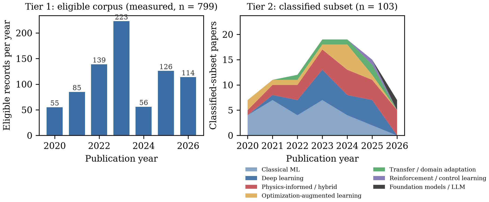

# Machine learning in battery management systems: a two-tier scoping review of 799 eligible studies with in-depth classification and validation audit

[](ML-BMS-Review.pdf)
[](ieee_submission/tex/mlbms.pdf)
[](ML-BMS-Corpus.xlsx)
[](#verification-methodology)

This repository is the complete, reproducible companion to the scoping review

> **Hussain Touhid Siddiquee, Syeda Salsabil Islam Ariya, Jasimul Islam Chowdhury**
> *Machine learning in battery management systems: a two-tier scoping review of 799 eligible studies with in-depth classification and validation audit.*
> Leading University, Sylhet, Bangladesh.

Two manuscript forms are maintained from the same source blocks and carry the same numbers:

| Form | File | Notes |
|---|---|---|
| Condensed TTE submission | `ieee_submission/tex/mlbms.tex` → `mlbms.pdf` | 18 pp., 4 figures, 8 tables, 111 references (incl. six standards documents); built by `corpus/build_tex.py --short` |
| Extended manuscript | `ML-BMS-Review.docx` / `.pdf` | 40 pp., 10 sections, 8 figures, 13 tables, 125 references (119 Crossref-verified + six standards documents); built by `build_docx.py` |

Every DOI in the **103-study classified subset** and the **conference descriptive set** was resolved directly against the [Crossref registry](https://api.crossref.org); the **799-record eligible corpus** is assembled entirely from Crossref-registered records with the mapping listed per record in `screening_log.csv`. Every number, figure, and table in the manuscripts can be regenerated from the released datasets with the released code (all scripts are repository-relative and run from the repo root).

---

## Contents

| Artifact | Description |
|---|---|
| [`ieee_submission/`](ieee_submission) | IEEE TTE submission package: IEEEtran source, compiled PDF, cover letter, submission figures |
| [`ML-BMS-Review.pdf`](ML-BMS-Review.pdf) / [`.docx`](ML-BMS-Review.docx) | The extended manuscript (40 pp., 13 tables, 125 references incl. six standards documents) |
| [`response_to_reviewers.pdf`](response_to_reviewers.pdf) / [`.docx`](response_to_reviewers.docx) | Point-by-point response dossier for the TTE review round (TTE-Reg-2026-09-3162) |
| [`cover_letter_TTE_v3.md`](cover_letter_TTE_v3.md) | Cover letter for the resubmission (supersedes v2) |
| [`ML-BMS-Corpus.xlsx`](ML-BMS-Corpus.xlsx) | Human-readable workbook: **Papers** (103, clickable DOI links), **Summary** (corpus counts), **Conference sensitivity** (14, clickable DOI links) |
| [`corpus/papers.csv`](corpus/papers.csv) | The 103-paper classified corpus (machine-readable; one row per study, 16 fields) |
| [`corpus/eligible_corpus.json`](corpus/eligible_corpus.json) | The 799-record rule-based eligible corpus (Tier 1; measured bibliometrics source) |
| [`corpus/screening_log.csv`](corpus/screening_log.csv) | Record-level screening provenance: status + reason for every decision — 1,550 pool records (883 retained at the title gate, 667 gate exclusions, 84 venue exclusions) plus 5 forced-seed entries |
| [`corpus/tagging_terms.json`](corpus/tagging_terms.json) | Released title-gate term lists (battery terms, ML terms) and the query-key → function-tag map |
| [`corpus/sensitivity_label_noise.json`](corpus/sensitivity_label_noise.json) | Label-noise scenario sensitivity of the headline validation counts (`sensitivity_label_noise.py`, seeded) |
| [`corpus/per_year_denominators.json`](corpus/per_year_denominators.json) | Crossref per-year result totals for the 30 queries (tested as trend denominators; documented as unusable — see manuscript §III-A) |
| [`corpus/protocol_audit.csv`](corpus/protocol_audit.csv) | Per-paper validation-protocol audit (strong flags under both definitions) |
| [`corpus/codebook.md`](corpus/codebook.md) | Classification codebook: field definitions, thresholds, absorbing rules |
| [`corpus/coding_protocol.md`](corpus/coding_protocol.md) | Independent re-coding protocol for coders 2–3 (blinding, dispute resolution, agreement thresholds) |
| [`corpus/reliability/coder_*_30.csv`](corpus/reliability) | Blind 30-paper coding sheets (stratified random draw, seed 20261017) |
| [`corpus/seeds.json`](corpus/seeds.json) | The six landmark seed studies safeguarded during retrieval |
| [`zenodo_upload.zip`](zenodo_upload.zip) | Ready-to-upload Zenodo deposit (data + codebook + reliability evidence + regeneration scripts; run from the extracted zip, verified) |
| [`corpus/conference_sensitivity.csv`](corpus/conference_sensitivity.csv) | The 14-paper conference set (8 learning-based under the pre-stated inclusion rule) |
| [`corpus/`](corpus) | Full pipeline: search, screening, verification, statistics, figures, document build |
| [`figures/`](figures) | All manuscript figures as 300-dpi PNGs |

## The corpus in one figure



*Two-tier trend figure (Fig. 3 of the submission).* Left: measured eligible-corpus records per year (capped retrieval; the 2024 dip is the documented retrieval hole, not a decline in the field). Right: classified-subset papers by year and method family, reviews shown as their own band — classical ML gives way to deep learning, then to physics-informed/hybrid approaches, with LLM-based studies appearing in 2025–2026.

## Headline findings

- **Two-tier evidence base.** Field-level bibliometrics are *measured* on a rule-based eligible corpus (799 records, 2020–2026 plus one Crossref-dated 2027 early-access record; no function quotas); in-depth classification and the validation audit live on the curated 103-study subset, with reconciliation checks between tiers (`consistency_check.py`).
- **Validation gap, quantified and tested.** Strong protocols (cross-cell / cross-chemistry / cross-domain holdout, online or fleet) cover 42 of 88 primary-application papers (48%; label-noise scenarios span 40–59%); 17 use within-cell or unsupervised k-fold splits that leak trajectory information; 23 papers rest on three public benchmarks (MATR/NASA/CALCE) and 36 on private laboratory cells — a two-pole data-fragmentation pattern.
- **Inter-coder reliability, measured.** Two independent coders blind-re-coded a 30-paper stratified sample: κ = 0.92 (function), 0.88 (method), 0.88 (data) pass; chemistry κ = 0.55 and validation κ = 0.48 fail the ≥ 0.66 threshold — traced to abstract-only evidence access (the coders had full texts for only 7 and 2 of the 30 papers); on the count-bearing strong/non-strong bucket the two coders agree 25/30 (83%, κ = 0.51). Sheets, `dispute_items.csv`, and the hash-tracked log are released; the two failing fields trigger v1.1 codebook patch candidates.
- **Physics-informed validation contrast is exploratory, not settled.** 36% vs 52% strong-protocol share (Fisher p = 0.32, OR 0.54, 95% CI 0.21–1.46); under the broader definition 59% vs 74%, OR 0.50, 95% CI 0.19–1.36, p = 0.19 — non-significant under both definitions, unadjusted confounding declared, and the family contrast stays non-significant in 95% of label-noise scenario draws.
- **Transportation-electrification cut + standards mapping.** Measured shares for vehicle/fleet-level work (≈2% of eligible records), a BMS-function-to-requirement map for UN GTR 20 / GB 38031-2020/2025 / ISO 26262:2018 / ISO/PAS 8800:2024 / ISO 21448 (SOTIF), and a positioning table against prior reviews.
- **Foundation-model guardrails.** An LLM-based SOH **estimator** among the subset's 2025–2026 entries is analyzed with its prior-art caveat stated (LLM-based battery estimation exists earlier outside the screened venues); Table V (Table 9 in the extended version) maps grounding, hallucination, uncertainty, latency, and safety-authority requirements — LLM components must never hold direct cell-level protection authority.
- **A reporting checklist.** Section IX-D (§9.7 in the extended version) proposes **BMS-ML-RC**, a 12-item CONSORT/PRISMA-style reporting checklist (Table VIII / Table 11) for future machine-learning BMS studies.

## Figures

The submission (short form) uses 4 of these; the extended manuscript uses all 8. Numbers below are the extended version's figure numbers; the submission's Fig. 4 is the benchmark-reuse figure.

| File | Extended # | Content |
|---|---|---|
| `fig1_function_method_map.png` | Fig. 1 | Function × method-family map of the 88 primary-application papers |
| `fig2_prisma.png` | Fig. 2 | Study-selection flowchart with the two-tier design (3,000 → 1,550 → 883 → 799 Tier-1 eligible → 103 classified subset) |
| `fig2_year_trend.png` | Fig. 3 | Subset composition by publication year with cumulative total (extended only) |
| `fig3_method_evolution.png` | Fig. 4 | Two-panel: eligible-corpus records per year + classified-subset method families (submission Fig. 3) |
| `fig4_area_distribution.png` | Fig. 5 | Application-area distribution (extended only) |
| `fig5_data_validation.png` | Fig. 6 | Data sources + validation approaches (extended only) |
| `fig7_dataset_saturation.png` | Fig. 7 | Benchmark reuse vs classified-subset output (submission Fig. 4) |
| `fig6_timeline.png` | Fig. 8 | Milestones timeline (extended only) |

## Verification methodology

1. **Retrieval.** 30 bibliographic query strings × 5 passes against the Crossref REST API on **4–5 September 2026** → 3,000 records.
2. **Deduplication.** DOI-based → 1,550 unique records (1,450 duplicates removed).
3. **Relevance screening.** Title must contain battery-related **and** ML-related terms → 883 (−667); all 1,550 title-gate decisions are logged in `screening_log.csv`, and the term lists are released in `tagging_terms.json`.
4. **Venue/document-type screening.** Journal articles only; conference abstracts, preprints, non-scholarly venues excluded → 799 (−84).
5. **Rule-based two-tier selection.** Tier 1: venue-screened 799 eligible records, included in full without function quotas (`corpus/eligible_corpus.json`); Tier 2: curated full-text-classified 103-study subset (98 from the eligible pool + 5 landmark seeds retrieved individually; record-level provenance in `corpus/screening_log.csv`, per-paper protocol audit in `corpus/protocol_audit.csv`, coding definitions in `corpus/codebook.md`).
6. **Verification.** Every DOI resolved directly against `api.crossref.org`; registry metadata compared to the record; per-paper citation counts (is-referenced-by-count, retrieved 5 September 2026) shipped in the dataset. External citations verified separately (`corpus/verify_external.py` → `corpus/external_verified.json`).

Full details: manuscript Section 2; screening funnel in `figures/fig2_prisma.png`.

## Reproducibility

### Requirements

- Python ≥ 3.10 with `openpyxl`, `matplotlib`, `python-docx`, `pandas`, `scipy`
- `curl` (network access to `api.crossref.org` and `api.semanticscholar.org`)
- `tectonic` (LaTeX, for the IEEE submission PDF) and LibreOffice (for DOCX → PDF)

### Pipeline

All commands run from the repository root. Every stage is cached/skips-safe; outputs land in `corpus/` and `figures/`.

```bash
# 1. Search: 30 queries x 5 passes from Crossref (~3,000 records -> corpus/raw/*.json)
bash corpus/fetch_crossref.sh

# 2. Pool + dedupe + relevance gate + venue gate (-> corpus/pool.csv)
python3 corpus/pool.py

# 3. Screening: stratified selection, landmark seeds, reclassification, curation
python3 corpus/screen.py
python3 corpus/fix_areas.py
python3 corpus/final_selection.py

# 4. Verification: resolve every DOI against Crossref, pull registry metadata
python3 corpus/verify_seeds.py
python3 corpus/verify_final.py

# 5. Statistics + consistency (every in-text number regenerates from here)
python3 corpus/build_stats.py
python3 corpus/consistency_check.py
python3 corpus/sensitivity_label_noise.py   # label-noise scenarios -> sensitivity_label_noise.json
python3 corpus/make_screening_log.py        # screening_log.csv (1,550 pool decisions) + tagging_terms.json

# 6. Figures (all PNGs, 300 dpi)
python3 corpus/make_fig1_heatmap.py   # Fig. 1 heatmap
python3 corpus/make_fig1.py           # Fig. 2 PRISMA funnel
python3 corpus/make_figs.py           # Figs. 2b/3-6 + Fig. 8 timeline
python3 corpus/make_fig7_saturation.py# Fig. 4/7 benchmark reuse

# 7. Manuscripts (citations [[doi]] -> numbered [n], tables, references)
python3 corpus/build_tex.py --short   # -> ieee_submission/tex/mlbms.tex (TTE submission)
cd ieee_submission/tex && tectonic mlbms.tex
python3 build_docx.py                 # -> ML-BMS-Review.docx (extended)
soffice --headless --convert-to pdf ML-BMS-Review.docx   # -> ML-BMS-Review.pdf

# 8. Spreadsheet companion (Papers / Summary / Conference sensitivity)
python3 corpus/make_xlsx.py           # -> ML-BMS-Corpus.xlsx

# 9. Reference audit: re-resolve every reference DOI and compare titles
python3 corpus/final_audit.py
```

`corpus/raw/` ships the cached Crossref responses from the original run, so stages 1–2 can be replayed offline; the released `corpus/papers_final.json`, `corpus/verified.json`, and `corpus/stats.json` pin the exact state behind the published figures.

### Single source of truth

`corpus/consistency_check.py` recomputes the paper's key statistics (function totals, review reconciliation, fleet/online overlap, validation breakdowns, method-family year counts) from `papers_final.json`. If any future edit changes the corpus, re-run it before touching the text.

## Repository structure

```
.
├── ieee_submission/               # IEEE TTE submission (tex + PDF + cover letter + figures)
├── ML-BMS-Review.docx / .pdf      # extended manuscript
├── ML-BMS-Corpus.xlsx             # Papers + Summary + Conference sensitivity
├── figures/                       # Figs. 1-8 (300 dpi PNG)
├── paper_part1.py / _2 / _3       # extended-manuscript text as structured blocks ([[doi]] citations)
├── paper_short_part1.py / _2 / _3 # condensed TTE-submission text (same block format)
├── build_docx.py                  # DOCX builder: citation resolution, tables, references
├── corpus/
│   ├── fetch_crossref.sh, queries.txt, raw/     # search stage (cached responses)
│   ├── pool.py, screen.py, fix_areas.py, final_selection.py   # screening
│   ├── verify_seeds.py, verify_final.py, final_audit.py       # Crossref verification + audit
│   ├── build_tex.py               # IEEEtran LaTeX builder (short variant with --short)
│   ├── papers.csv, papers_final.json, verified.json, stats.json
│   ├── conference_sensitivity.csv, conference_verified.json   # conference descriptive set
│   ├── make_figs.py, make_fig1.py, make_fig1_heatmap.py, make_fig7_saturation.py
│   ├── make_xlsx.py, consistency_check.py, build_stats.py
│   └── ...
└── README.md
```

## Dataset schema (papers.csv)

| Field | Meaning |
|---|---|
| `doi` / `title` / `authors` / `journal` / `year` / `volume` / `issue` / `pages` | Crossref-verified bibliographic metadata |
| `area` | Management function (8 values, incl. cross-cutting) |
| `method` | Dominant method family (13 values) |
| `chem` | Electrochemistry (NMC, LFP, LCO, Li-metal, Li-S, mixed, various) |
| `data` | Primary data source (own lab, public benchmark, EIS lab, fleet, simulation, …) |
| `valid` | Validation approach (cross-cell holdout, within-cell split, hardware, online/fleet, …) |
| `finding` / `limit` | Coded headline finding and principal limitation |
| `cites` | Crossref is-referenced-by-count at retrieval (5 September 2026) |

## Citation

If this corpus or checklist is useful, please cite the manuscript:

```bibtex
@article{siddiquee2026mlbms,
  title  = {Machine learning in battery management systems: a two-tier scoping review
            of 799 eligible studies with in-depth classification and validation audit},
  author = {Siddiquee, Hussain Touhid and Ariya, Syeda Salsabil Islam and
            Chowdhury, Jasimul Islam},
  year   = {2026},
  note   = {Manuscript and verified corpus; this repository}
}
```

## Provenance and AI disclosure

The bibliographic corpus is machine-curated and human-verified: classification fields were coded by the lead author with conservative coding from full texts, and their reliability is documented through a 30-paper blind inter-coder re-coding study (three of five fields above the κ ≥ 0.66 threshold, two below, with label-noise sensitivity ranges on every headline validation count — see manuscript §2.5/§II-C). Writing-support and language-enhancement tools (ChatGPT, Grammarly, QuillBot) were used for grammar, readability, and restructuring; all technical content, analysis, interpretations, and research contributions are the authors' own (see the Acknowledgment section of the manuscript).
